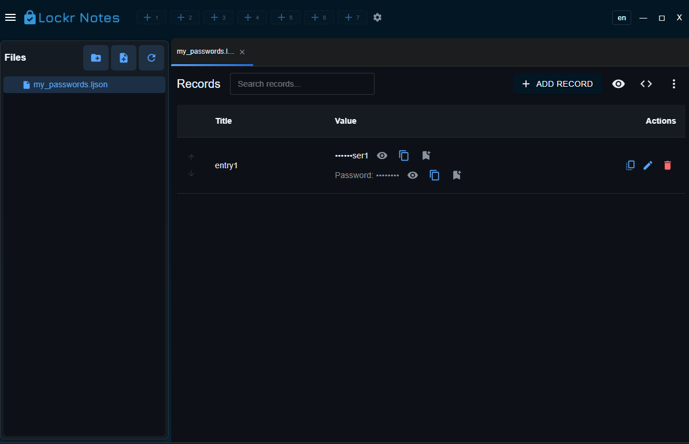

<h1 align="center">Lockr Notes</h1>

<p align="center">
  A local desktop app for notes, passwords, and logins. Optional encryption. Open source.
</p>

<br>

<div align="center">

[![Build Status][github-actions-status]][github-actions-url]
[![Github Tag][github-tag-image]][github-tag-url]
[](https://discord.gg/Fjy3vfgy5q)

</div>

<br>

<p align="center">
  
</p>

<br>

## What it is

**Lockr Notes** keeps your notes, passwords, and logins on your own computer, in a folder you choose. Write plain text. Store structured entries for sites, SSH, and remote desktops. Lock a file with encryption when it should stay private. When you need the site itself, open it in the built-in browser, right next to the password that gets you in.

Organize everything in a folder tree, with tabs and autosave, in **English** or **pt-BR**. Nothing here asks you to create an account or upload your notes.

The project is **open source** ([MIT](LICENSE)). The code lives at [github.com/elongvieira/lockrnotes](https://github.com/elongvieira/lockrnotes).

**Lockr Notes** guarda suas notas, senhas e logins no seu próprio computador, na pasta que você escolher. Escreva texto livre. Guarde entradas estruturadas para sites, SSH e área de trabalho remota. Tranque um arquivo com criptografia quando ele precisar ficar privado. Quando precisar do site, abra-o no navegador interno, ao lado da senha que entra nele.

Organize tudo em uma árvore de pastas, com abas e salvamento automático, em **inglês** ou **pt-BR**. O app não pede conta e não envia suas notas para um servidor.

O projeto é **open source** ([MIT](LICENSE)). O código está em [github.com/elongvieira/lockrnotes](https://github.com/elongvieira/lockrnotes).

## Main features

- **Local storage** — a `LockrNotes` folder in Documents by default, or any path you set.
- **Notes and structured entries** — plain text (`.txt`) and JSON (`.json`) for passwords, web logins, SSH, and RDP.
- **Built-in browser** — open a site from a login entry, with a browser session isolated per entry.
- **SSH terminal and RDP** — connect from the entry you already saved, only when you use those actions.
- **Quick copy** — keep frequently copied fields one click away.
- **Managed encryption** — AES-256-GCM. The master key stays in the operating system vault, or optionally in the app folder.
- **Password encryption** — protect a file with a password you choose.
- **Interface** — dark theme, tabs, autosave, **English** and **pt-BR**.
- **Import and export** — back up or move your notes folder.

## Privacy and security

Lockr Notes is built for people who want their notes under local control:

| Topic | Behavior |
|--------|----------------|
| **Where data lives** | In the folders you choose on disk. The app does not host your notes on its own server. |
| **App settings** | Encrypted `config.enc` in the Electron `userData` directory. |
| **File encryption** | Optional. AES-256-GCM. New files use HKDF (managed encryption) or PBKDF2 with 600,000 iterations (password). Older files still open. |
| **Encryption key** | Recommended mode: the system vault (`safeStorage`: DPAPI on Windows, Keychain on macOS). Storing the key in the folder does not make the vault portable: the file stays encrypted by the system, bound to this user and this computer. |
| **No key recovery** | Reinstalling the system or losing the vault makes managed encryption unreadable. There is no recovery password. For notes that must survive that, use password encryption. |
| **Export** | The export ZIP contains notes in clear text. The app asks for confirmation before creating it. |
| **Content telemetry** | The app **does not send the text of your notes** to Lockr Notes services. |
| **Network** | Connections happen when **you** use web login, SSH, or RDP, and when an **installed build** checks GitHub for updates. |
| **Backups** | **Your responsibility.** Disk loss, accidental deletion, or a lost key can make data unrecoverable. |

Also read [TERMS.md](TERMS.md) (terms of use) and [SECURITY.md](SECURITY.md) (how to report vulnerabilities in private).

> **Important:** Encryption and careful use reduce risk. No software removes every chance of data loss or misuse. Use it at your own risk.

## Feedback

- **Issues and ideas:** [github.com/elongvieira/lockrnotes/issues](https://github.com/elongvieira/lockrnotes/issues)
- **Discord:** [discord.gg/Fjy3vfgy5q](https://discord.gg/Fjy3vfgy5q)

Contributions follow [CONTRIBUTING.md](CONTRIBUTING.md) and the [Code of Conduct](CODE_OF_CONDUCT.md).

---

## Development

Stack: [Electron](https://electronjs.org/) + [React](https://react.dev/) + TypeScript.

### Clone and install

```bash
git clone --depth 1 --branch main https://github.com/elongvieira/lockrnotes.git
cd lockrnotes
npm install
```

### Run in development

```bash
npm run dev
```

Same as `npm start` (webpack + Electron).

### Package

```bash
npm run package
```

### Tests and lint

```bash
npm test
npm run lint
```

### Semantic Release

Commits on `main` follow [Conventional Commits](https://www.conventionalcommits.org/) so CI can version the project:

```bash
feat: add a new entry type
fix: prevent sidebar crash on empty folder
chore: update dependencies
```

---

## Base project

This repository grew from [Electron React Boilerplate](https://github.com/electron-react-boilerplate/electron-react-boilerplate) (MIT).  
Current changes and features: **Elon Gomes Vieira**.

## License

MIT © 2025 Elon Gomes Vieira — see [LICENSE](https://github.com/elongvieira/lockrnotes/blob/main/LICENSE).

[github-actions-status]: https://github.com/elongvieira/lockrnotes/workflows/Test/badge.svg
[github-actions-url]: https://github.com/elongvieira/lockrnotes/actions
[github-tag-image]: https://img.shields.io/github/tag/elongvieira/lockrnotes.svg?label=version
[github-tag-url]: https://github.com/elongvieira/lockrnotes/tags
